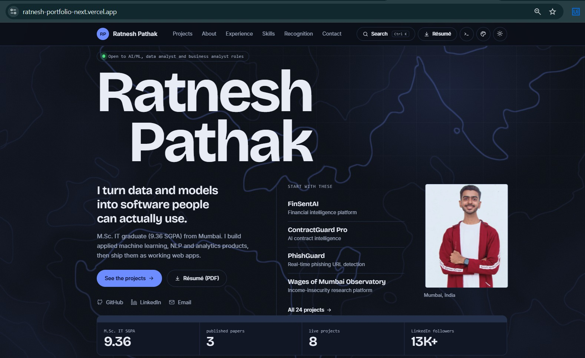
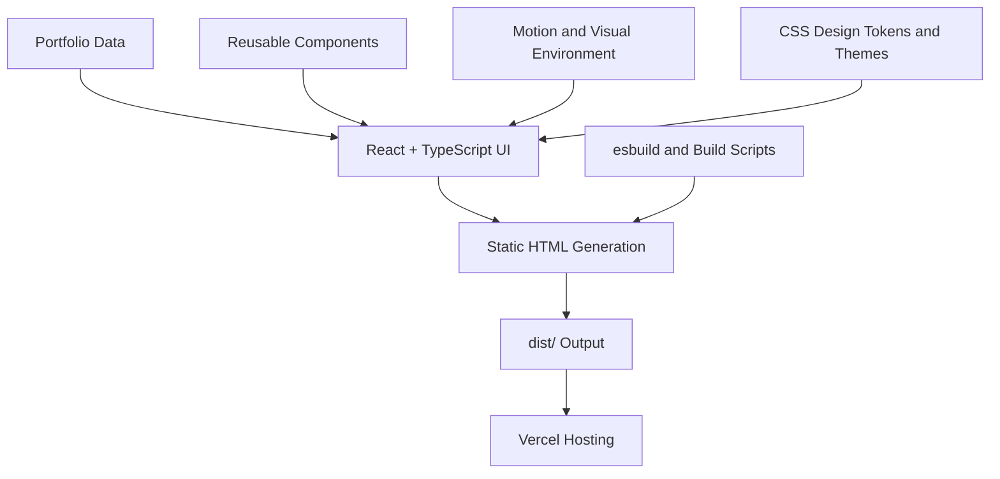

# Ratnesh Pathak — Portfolio Next

  
  

  A next-generation personal portfolio featuring immersive motion, interactive project exploration, a command palette, a virtual terminal, and a carefully crafted responsive experience.

  <b>AI/ML Engineer · Full-Stack Developer · Researcher · Founder, Team Ignites</b>

---

## Overview

**Portfolio Next** is a standalone, modern portfolio experience designed to present my projects, technical expertise, education, professional experience, research, achievements, and event participation through an interactive interface.

Rather than relying on a conventional static portfolio layout, the experience combines editorial-inspired visual design, purposeful animations, interactive discovery tools, and accessibility-conscious engineering.

The application is deployed on Vercel and built using React, TypeScript, custom CSS, and a custom static-site build pipeline.

> **Explore the live experience:** [ratnesh-portfolio-next.vercel.app](https://ratnesh-portfolio-next.vercel.app/)

### Portfolio Preview

  

  <a href="https://ratnesh-portfolio-next.vercel.app/">
    <strong>🚀 Explore the Live Portfolio</strong>
  </a>

## Highlights

| Feature | Description |
| --- | --- |
| Interactive Project Explorer | Search, filter, sort, and open detailed project dialogs with shareable deep links. |
| Visual Project Map | Explore connected project nodes grouped by subject area and shared technologies. |
| Command Palette | Navigate sections, open projects, copy contact information, and switch appearance using `Ctrl/⌘ + K` or `/`. |
| Interactive Terminal | Explore projects, skills, research, events, and contact information using commands, keyboard navigation, and tab completion. |
| Achievements & Events | Browse achievements and event highlights through detail dialogs, optional photo galleries, and deep links. |
| Personalized Themes | Switch between dark and light modes and select an accent palette. |
| Motion & Visual Effects | GSAP, ScrollTrigger, CSS transitions, and an optional WebGL2 background enhance the experience. |
| Responsive Design | Adapted layouts and lighter visual effects for mobile devices. |
| Accessibility | Semantic structure, descriptive image text, keyboard-accessible controls, and reduced-motion support. |
| Search-Friendly Pages | Static HTML generation, page metadata, and build-time SEO support. |

## Technology Stack

  
  
  
  
  
  
  

| Area | Technologies |
| --- | --- |
| UI | React 19, TypeScript, JSX |
| Compatibility | Preact through `preact/compat` aliases |
| Styling | Custom CSS, design tokens, CSS transitions |
| Animation | GSAP, ScrollTrigger, CSS-based motion |
| Graphics | Inline SVG, optional WebGL2 background |
| Build system | esbuild and static HTML generation |
| Quality assurance | TypeScript checks, build verification scripts |
| Hosting | Vercel |

**Architecture note:** Despite the `portfolio-next` repository name, this project does not use Next.js. It uses a custom static build pipeline.

## Architecture

The application separates content, interface components, animation behavior, and build tooling to keep the portfolio maintainable.

## Design & Engineering Decisions

- **Static-first delivery:** Generate HTML at build time so important portfolio content is not dependent entirely on client-side JavaScript.
- **Progressive animation:** Use CSS for the initial hero entrance and load heavier GSAP choreography lazily.
- **Graceful visual fallbacks:** Provide a static alternative to the optional WebGL background.
- **Mobile-conscious effects:** Avoid heavier animation and WebGL paths on mobile layouts.
- **Accessible motion:** Respect `prefers-reduced-motion` and simplify nonessential animation when requested.
- **Content-driven architecture:** Keep projects, experience, skills, education, and achievements in dedicated data modules.
- **Shareable exploration:** Support deep links for project and achievement dialogs.
- **Build-time validation:** Check important structural, metadata, and asset requirements through verification scripts.

These decisions describe the implementation approach; performance and accessibility should still be validated on real devices and assistive technologies.

## Project Sections

The portfolio brings together several areas of my professional and personal work:

- **Projects:** AI/ML applications, full-stack development, data analytics, and other technical builds.
- **Technical Skills:** Technologies and tools used across my work.
- **Experience:** Professional and internship experience.
- **Education:** Academic background and qualifications.
- **Research:** Publications and research-related work.
- **Achievements:** Academic, technical, and extracurricular recognition.
- **Events:** Hackathons, technical events, and community participation.
- **Contact:** Professional links, contact information, and résumé access.

For the complete experience, visit the [live portfolio](https://ratnesh-portfolio-next.vercel.app/).

## Screenshots

Screenshots will be added to this showcase as the visual documentation is prepared.

Planned captures:

- `screenshots/hero-desktop.png` — Main landing page
- `screenshots/projects-explorer.png` — Interactive project explorer
- `screenshots/project-map.png` — Connected project map
- `screenshots/command-palette.png` — Keyboard-driven navigation
- `screenshots/interactive-terminal.png` — Terminal interface
- `screenshots/achievements.png` — Achievements and events
- `screenshots/mobile-view.png` — Responsive mobile experience

*These are planned screenshot filenames, not existing image files. Images will be included as they are captured.*

## Live Demo

**[Launch Portfolio Next →](https://ratnesh-portfolio-next.vercel.app/)**

The live site is hosted on Vercel. The deployed experience may evolve as new improvements and content updates are released.

## Source Code & Repository

The application's source code is maintained in a separate private repository.

- **Live application:** [ratnesh-portfolio-next.vercel.app](https://ratnesh-portfolio-next.vercel.app/)
- **GitHub profile:** [github.com/RatneshPathak](https://github.com/RatneshPathak)
- **Public project showcase:** This repository

The public showcase contains project documentation and approved screenshots only. It does not distribute the private application's source code, build scripts, configuration, or repository history.

## About the Developer

I'm Ratnesh Pathak, an AI/ML engineer and full-stack developer interested in building useful AI-powered applications, interactive web experiences, and data-driven solutions.

My work spans machine learning, computer vision, data analytics, research, application development, and collaborative technical projects.

I'm also the founder of **Team Ignites**, where I work on technology-driven ideas and projects.

  
  
  

---

  Designed and developed by <b>Ratnesh Pathak</b>
   
  <i>Building thoughtful interfaces and impactful technology.</i>

